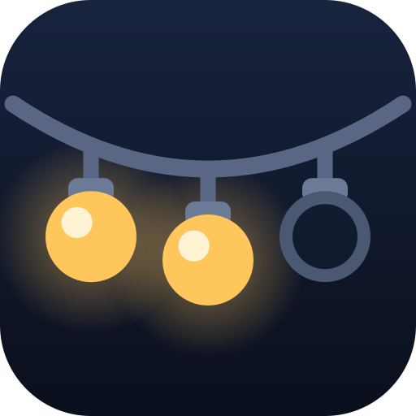
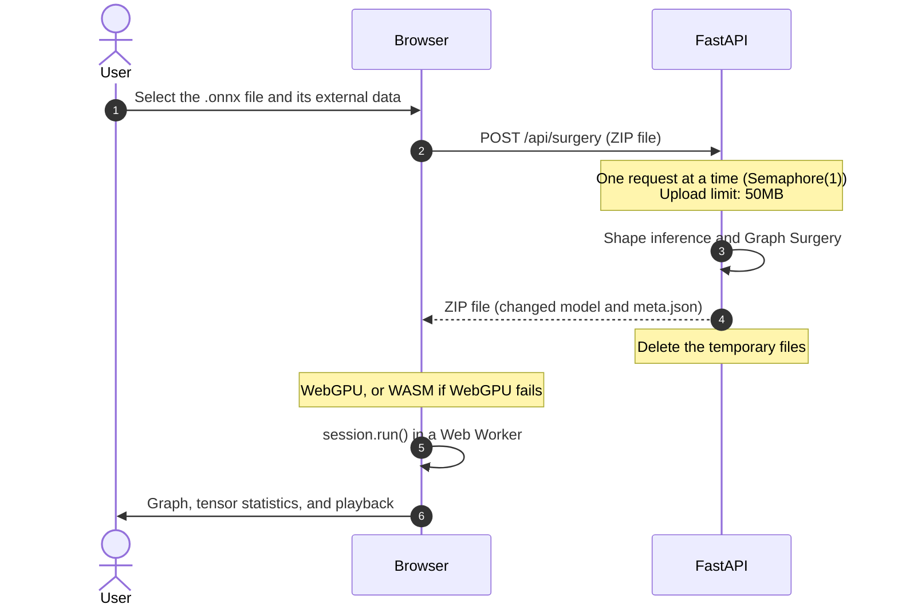

<!-- Each icon has its own background plate. Thus, select the icon that contrasts with
     the page, not the icon that matches it. The navy plate shows well on the light theme
     of GitHub. The pale plate shows well on the dark theme. The file names suggest the
     opposite. -->
<picture>
  <source media="(prefers-color-scheme: dark)" srcset="apps/web-app/src/assets/icon/amber-light.svg">
  
</picture>

# StringLights

**Find the node where your ONNX model starts to give wrong values.**

StringLights promotes each intermediate tensor of your model to a graph output.
Thus, one run of the model returns all of these tensors.
StringLights runs the model in your browser. Then you can step through the forward pass
one node at a time, with the tensor statistics of each step.

The server only rewrites your model. It does not run the model, and it deletes the model
after it sends the response.

[](https://github.com/Utaewook/StringLights/actions/workflows/deploy.yml)
[](https://string-lights.dev/)


[](https://ko-fi.com/twyou)

### [Try it at string-lights.dev](https://string-lights.dev/)

You do not have to install anything or make an account. You only need an ONNX file.

<!-- TODO(assets): Replace this comment with docs/design/assets/demo.gif. The GIF shows
     the upload, a node click, and the playback in one loop. -->

---

## Why

A graph viewer shows the structure of a model. It does not show the values in the model.
For example, it does not show that layer 47 starts to give `NaN` values.
It also does not show that a normalization layer sets all values to zero.

Usually, you find these problems with this procedure:

1. Edit the export script.
2. Add one tensor to the output list.
3. Export the model again.
4. Run the model and print the tensor.
5. Do these steps again for the next node.

Each repetition examines only one node. On a model with hundreds of nodes, this procedure
takes many hours.

StringLights does this for all nodes at one time. It promotes every intermediate tensor to a
graph output. Thus, one run gives you every tensor in the model
(see [ADR 0001](docs/decisions/0001-promote-all-intermediate-outputs.md)).

---

## How it works

1. **Upload.** Select your `.onnx` file. If the model has external data files, select them
   too. The upload limit is 50MB for all files together.
2. **Inspect.** Click a node in the graph. The inspector shows the dtype and the shape of its
   tensor. It also shows the tensor statistics: the minimum, the maximum, the mean, the
   standard deviation, a flag for `NaN`, and a flag for `Inf`.
3. **Playback.** Use the playback to step through the forward pass, one node at a time.
   You can move forward or backward. Find the node where the values become wrong.

<!-- TODO(assets): Add three screenshots: the upload panel, the inspector, and the
     playback bar. -->

---

## Features

- **All intermediate tensors in one run.** One Graph Surgery promotes every intermediate
  tensor to a graph output. You do not change the export script, train again, or add code
  to the model.
- **Tensor statistics for each node.** The app calculates the minimum, the maximum, the
  mean, and the standard deviation of each tensor. It also finds `NaN` and `Inf` values.
  It shows these values with the dtype and the shape that the model declares.
- **Step-by-step playback.** The playback goes through the forward pass. You can play,
  pause, step, and seek. The graph canvas highlights the active node.
- **Synthetic inputs.** You do not need a dataset. The app gives the model zeros or random
  values, with a batch size that you select.
- **WebGPU with an automatic WASM fallback.** The session reports its execution provider.
  If the session uses WASM on the CPU, the UI shows a badge.
- **Inference outside the UI thread.** The `InferenceSession` runs in a Web Worker. Thus, a
  large model does not stop the page.

---

## Architecture

**The server does not run inference.** The backend does not install `onnxruntime`, and the
project does not permit it there. The backend imports only `onnx`, and it uses `onnx` only
to rewrite the graph.

This rule started as a limit of the host. The project runs on a host with 512MB of memory,
and that host cannot run an inference runtime. Now the rule is also important for your
privacy:

- The server rewrites your model and sends it back. Then it deletes the temporary files.
- The server loads the weights only to rewrite the model. It does not run them, and it does
  not keep them.



[docs/guide/03_architecture.md](docs/guide/03_architecture.md) gives the full data flow.

---

## Quick start

You do not have to install anything to use **[string-lights.dev](https://string-lights.dev/)**.
Use these steps only to run your own copy.

### Docker

```bash
cd build
docker compose up -d
```

Nginx serves the app on port `80`. The backend is not open to the host. Nginx sends the
requests to it.

### Local development

Backend (Python 3.12 or later):

```bash
cd apps/backend
python -m venv venv && source venv/bin/activate
pip install -r requirements.txt
uvicorn app.main:app --host 0.0.0.0 --port 8000 --reload
```

Frontend (Node 20 or later):

```bash
cd apps/web-app
npm install
npm run dev
```

Vite sends `/api` requests to port `8000`. Vite also sets the `Cross-Origin-Opener-Policy`
and `Cross-Origin-Embedder-Policy` headers. WASM with threads needs these headers.
If you serve the built files with a different server, set these headers on that server too
(see [ADR 0002](docs/decisions/0002-coep-require-corp.md)).

---

## Limits and current status

StringLights is a **preview**. The main flow works from the upload to the playback.
The project records the known problems in [docs/issues/](docs/issues/).

| Limit | Value | Reason |
| --- | --- | --- |
| Upload limit | 50MB for all files together | The host has 512MB of memory. The backend container has 350M. |
| Model files | One `.onnx` file in each upload | If an upload has more than one model, the backend refuses it. It does not guess. |
| Opset | 7 to the highest opset of the pinned `onnx` (27 now) | The upper limit comes from the pinned library, not from a fixed number. The browser runtime has its own limits and reports its own errors. |
| Graph Surgery | One request at a time | The other requests wait in a queue. Thus, they do not compete for memory. |

Read these known limits before you report a bug:

- **You cannot inspect the intermediate tensors inside `If`, `Loop`, or `Scan`.** The graph
  shows these nodes and labels them. But a subgraph runs only on a condition, so its tensors
  are not in the main graph. Thus, the surgery cannot promote them
  ([010](docs/issues/010-subgraph-nodes-never-surfaced.md)).
- **The app sets each dynamic axis other than the batch axis to 1.** For example, a sequence
  length gets 1. Before a run, the app shows the resolved shape beside the declared shape.
  Thus, you can see the guess. You cannot select the length yet
  ([017](docs/issues/017-non-batch-dynamic-axes-are-guessed.md)).
- **The app refuses `float16` and `string` inputs.** It does not approximate them. Issue
  [005](docs/issues/005-input-tensor-dtype-mismatch.md) gives the reason.

---

## Documentation

| Document | Contents |
| --- | --- |
| [Project overview](docs/guide/01_project_overview.md) | Goals, stack, and hardware limits |
| [Terminology](docs/guide/02_terminology.md) | Core terms, and the names to use for them |
| [Architecture](docs/guide/03_architecture.md) | The full request flow and data flow |
| [Conventions](docs/guide/04_convention.md) | Branches, commits, and coding rules |
| [Deployment](docs/guide/05_deployment.md) | Runtime topology, CI pipeline, certificates, and releases |
| [Writing standard](docs/guide/06_writing_standard.md) | Writing rules for documents and replies (ASD-STE100) |
| [Decisions](docs/decisions/) | ADRs: each decision and its trade-offs |
| [Issues](docs/issues/) | Known problems, with their severity and status |

[docs/design/direction.md](docs/design/direction.md) gives the design direction of the UI.

---

## Support

StringLights is free. It runs your model in your browser, and you do not need an account.
If StringLights helps you, you can support the project on [Ko-fi](https://ko-fi.com/twyou).

---

## License

Apache-2.0. See [LICENSE](LICENSE) and [NOTICE](NOTICE).
