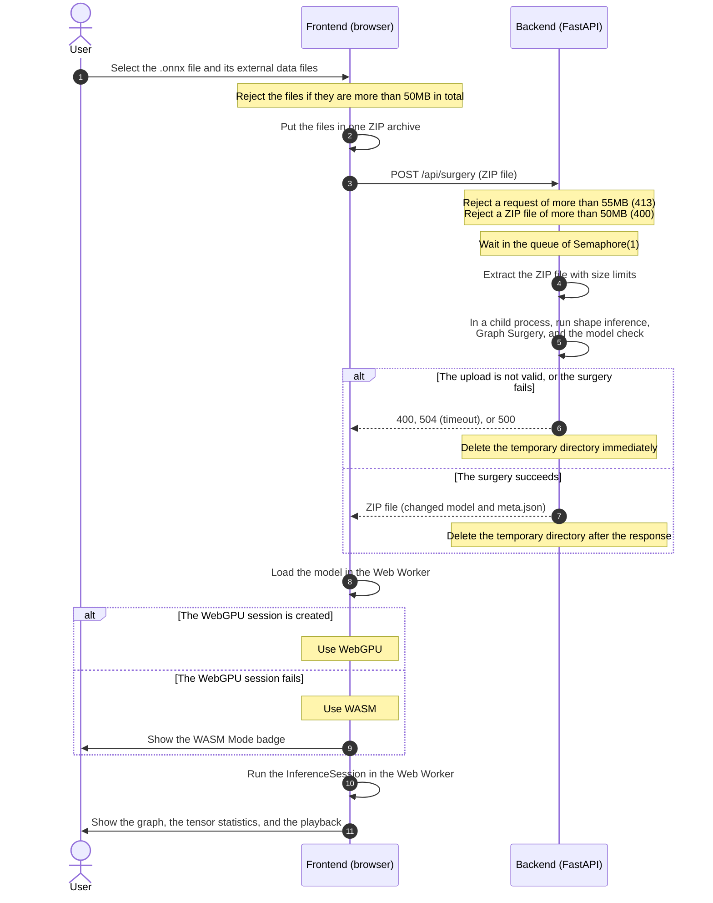

# Architecture and Data Flow

The main rule of the architecture is that the server does not run models.
The backend changes the model. The frontend runs the model.
This separation protects the small memory of the server.

---

## 1. Backend (FastAPI)

**Responsibility:** The backend receives an ONNX model and does Graph Surgery on it. Then it returns the changed model and deletes its temporary files.

**Limit:** The server does not run ONNX inference. Do not use the `onnxruntime` library in the backend.

**Protection against OOM:** Four limits protect the memory of the backend container (350M). Each limit controls a different quantity.

- `asyncio.Semaphore(1)` lets only one Graph Surgery run at a time. The other requests wait in a queue.
- The upload has two size limits:
  - If the `Content-Length` of a request is more than 55MB, the middleware returns `413`. It does not read the body.
  - If the uploaded ZIP file is more than 50MB, the endpoint returns `400 Bad Request`.
- Extraction has a limit of 150MB for all files and 80MB for the model. The backend checks the ZIP headers and also the bytes that it writes.
- Surgery runs in a child process, with a timeout of 90 seconds.

The upload limit controls the size of the archive. It does not control the size of the extracted files. Thus, extraction has its own limits.

Python cannot stop a thread, but it can stop a child process. Thus, the timeout really stops the surgery.
When the child process stops, the operating system gets back all memory that `onnx` used.

**Responsiveness:** During a surgery, the event loop only waits for the child process.
Thus, `/api/health` and the other endpoints continue to answer.

## 2. Frontend (onnxruntime-web)

**Responsibility:** The frontend sends the model to the backend and receives the changed model. Then it runs inference and shows the results.

- The results stay in memory, in the Zustand store. The frontend does not save them in a browser database.

**Web Worker:** The `InferenceSession` runs in a Web Worker (`src/ort-worker.ts`). Thus, inference does not stop the UI thread.

**Execution provider:**

- Before the worker loads a new model, it releases the current session.
- The worker tries to create a WebGPU session first. It does not check for WebGPU support before it tries.
- If the WebGPU session fails, the worker creates a WASM session.
- When the session uses WASM, the UI shows the badge `WASM Mode — Performance May Be Degraded`.

---

## 3. Data flow

---

## 4. Next documents

- [CLAUDE.md (session rules and trigger routing)](../../CLAUDE.md)
- [Project overview (01_project_overview.md)](./01_project_overview.md)
- [Terminology (02_terminology.md)](./02_terminology.md)
- [Coding rules (04_convention.md)](./04_convention.md)
- [Deployment and certificate lifecycle (05_deployment.md)](./05_deployment.md)
- [Writing standard (06_writing_standard.md)](./06_writing_standard.md)
